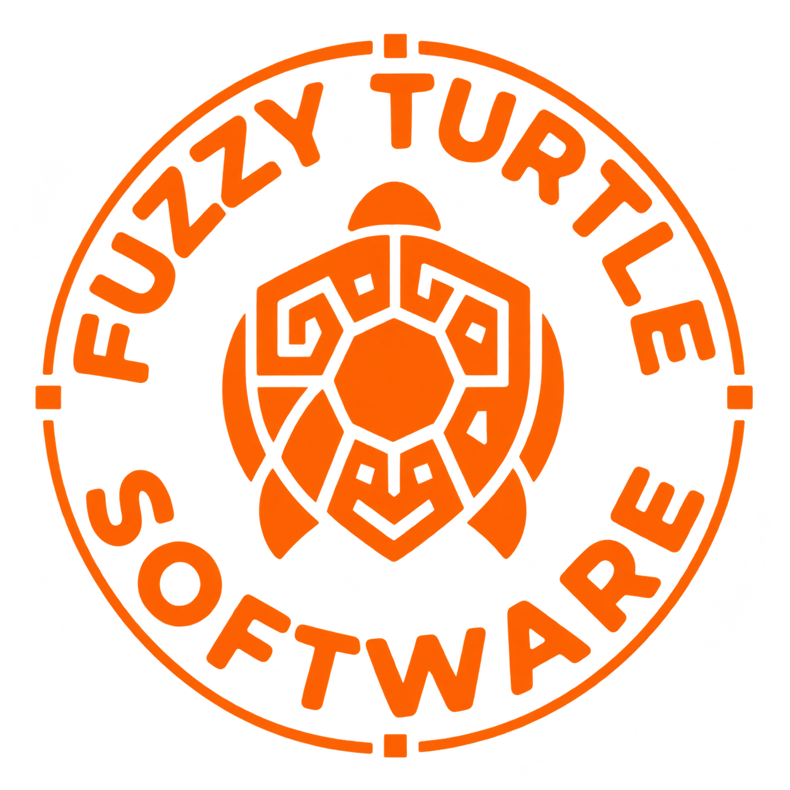

<p align="center"></p>

# Fuzzy Turtle Software 🐢

**Light, independent and connected creative apps for audio, video, VJing and music — for macOS, Linux and Raspberry Pi.**

*Suite d'applications créatives légères, indépendantes et reliées entre elles (audio, vidéo, VJing, musique) — pour macOS, Linux et Raspberry Pi.*

> ⚠️ **Status: early design stage.** Specifications are written, development is starting. Nothing is ready to install yet.

---

## The idea

Instead of one huge, complex application, Fuzzy Turtle is a family of small apps. Each one does a few things well, starts fast, runs on modest hardware, and hands work over to the others with one click ("Open in…" / "Send back").

- **Lightness first** — every app must stay usable on a Raspberry Pi 5. Heavy features (AI stem separation, advanced denoising…) are enabled only when the hardware can handle them.
- **Simplicity and creativity before complexity** — clean interfaces, advanced settings folded away.
- **Independent modules** — each app installs and runs on its own; a small hub ties them together.
- **Open by default** — GPLv3 source code, documented file formats.

## The apps

| App | What it does | Status |
| --- | --- | --- |
| **Fuzzy Audio Converter** | Audio format conversion | Done |
| **Fuzzy Commander** | Dual-pane file manager | Specified |
| **Fuzzy Hub** | Dashboard: launches the apps and passes files between them | Specified |
| **Fuzzy Quick Audio Editor** | Quick audio editing, effects, VST3/AU/LV2/CLAP plugins, stem separation, light multitrack | Specified |
| **Fuzzy VJing Player** | Live video mixing, cameras, BPM-synced effects, MIDI & Maschine control, DMX | Specified |
| **Fuzzy Quick Video Editor** | Multitrack video editing, light GPU effects, transitions, LUTs, subtitles | Specified |
| **Fuzzy John DAW Pulses** | Pattern- and pad-based DAW in the spirit of Maschine, driven by Maschine MK3 / Maschine+ | Specified |

## Platforms

| Platform | Priority |
| --- | --- |
| macOS (Intel & Apple Silicon), Sonoma 14 or later | Main |
| Linux x86-64 | Main |
| Raspberry Pi 5 / Pi 500 (8 GB) | "Light" profile |
| Raspberry Pi 4 / Pi 400 | Best effort |
| Windows | Later |

## Hardware support (planned)

- Any **USB class-compliant** audio interface (Core Audio, ALSA, PipeWire)
- **Native Instruments Maschine MK3 & Maschine+** (controller mode), driven directly over HID — pads, encoders, LEDs and both 480 × 272 colour screens, on macOS *and* Linux / Pi
- USB and DIN **MIDI** controllers through a simple mapping bridge (Akai MPD, Novation Launchpad / Circuit, Ableton Push, Roland SP-404…)
- Webcams, Pi cameras and USB HDMI capture devices
- **Ableton Link** and **MIDI Clock** for tempo sync

## Technology

| Area | Building blocks |
| --- | --- |
| Language | C++20 (Python for prototyping) |
| User interface | Qt 6 (Widgets + QML) |
| Audio engine | JUCE (headless), Tracktion Engine (DAW) |
| Video | FFmpeg, MLT Framework, GLSL shaders (`fuzzy-fx`) |
| Analysis | aubio (tempo, onsets), libKeyFinder (key) |
| Control | hidapi, RtMidi, OSC, Ableton Link |
| Build | CMake, GitHub Actions |

## Repository layout (planned)

```
fuzzy-turtle/
├── docs/            Specifications (project format, OSC protocol, app specs)
├── libs/
│   ├── fuzzy-core/     Hardware probe, .fuzzy project format, OSC, settings
│   ├── fuzzy-ui/       Shared Qt theme and widgets
│   ├── fuzzy-audio/    Audio engine, plugin host, audio effects
│   ├── fuzzy-fx/       Video effects (GLSL shaders) and renderer
│   └── fuzzy-control/  MIDI, HID, Maschine driver, controller mapping
├── apps/
│   ├── hub/
│   ├── audio-editor/
│   ├── vjing-player/
│   ├── video-editor/
│   └── daw-pulses/
└── prototypes/      Throw-away experiments (Maschine HID, Qt + JUCE, Pi shaders)
```

## Roadmap

1. **Foundation** — `.fuzzy` project format, OSC protocol, hardware probe, shared theme, first Hub
2. **Fuzzy Quick Audio Editor** V1.0
3. **Fuzzy Control** — Maschine MK3 / Maschine+ and MIDI bridge
4. **Fuzzy VJing Player**
5. **Fuzzy Quick Video Editor**
6. **Fuzzy John DAW Pulses**

## Licence

Source code is released under the **GNU General Public License v3.0** — see [LICENSE](LICENSE).

The name **"Fuzzy Turtle Software"** and its logo are not covered by the GPL: forks are welcome, but please use a different name.

Fuzzy Turtle is an independent project and is **not affiliated with Native Instruments**. Maschine, Kontakt and related names are trademarks of their respective owners.

## Support the project

Ready-to-use builds and content packs (effects, LUTs, sample kits) will be available at pay-what-you-want prices on itch.io, and donations on Ko-fi. Links coming soon.

## Contributing

The project is at a very early stage. Ideas, feedback and testing on Raspberry Pi are welcome — feel free to open an issue.
